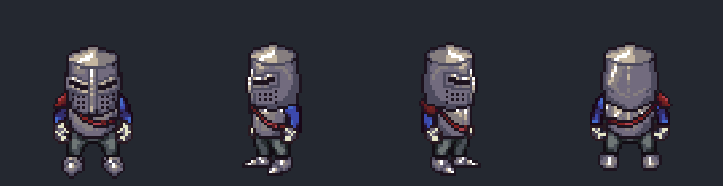
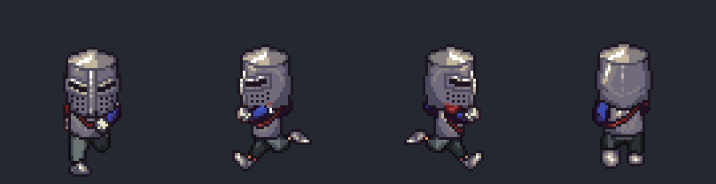
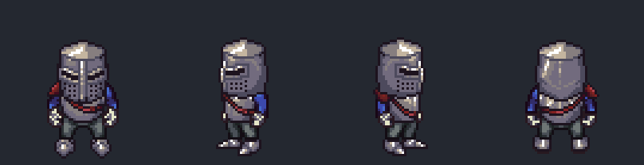
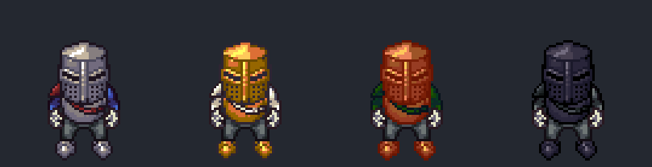
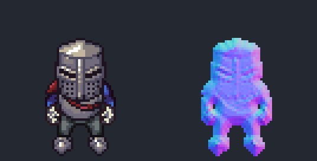
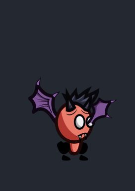
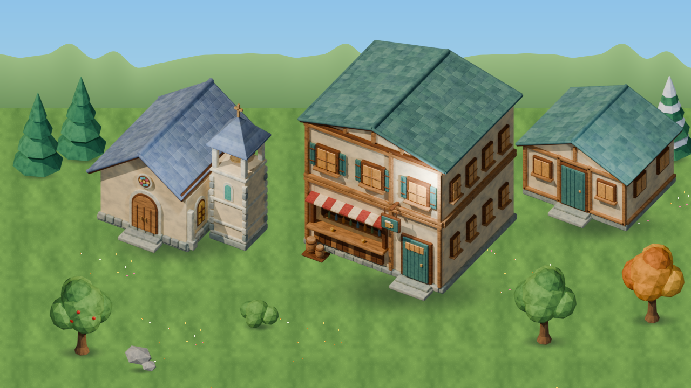

# godot-sprite-mcp

Headless MCP server (stdio) that composes 2D sprite sheets and scenes for Godot 4 using local pixel-buffer operations.
The same inputs produce byte-identical PNGs, SpriteFrames resources (`.tres`), and scenes (`.tscn`).

## Examples

Everything below is real tool output, regenerated with `bun run examples` (`scripts/examples.ts`).
The animated previews are scaled 3× with nearest-neighbour sampling; the files a tool writes are the
originals in [`docs/examples/`](docs/examples).

### A knight soldier with 4-direction movement

> *"Make a knight soldier sprite sheet: steel plate armour, great helm, red shoulder guards, ready to walk and run in Godot."*

An MCP client turns that into one `compose_character_sprite` call. Each part is a layer from the
`lpc_male` library, and each palette recolours that layer:

```json
{
  "library": "lpc_male",
  "name": "knight",
  "parts": {
    "torso": "longsleeve", "legs": "pants", "feet_armour": "plate_boots", "torso_armour": "plate",
    "shoulders": "bauldron", "gloves": "gloves", "helmet": "greathelm"
  },
  "palettes": {
    "torso": "navy", "legs": "charcoal", "torso_armour": "steel", "feet_armour": "steel",
    "gloves": "iron", "helmet": "steel", "shoulders": "maroon"
  },
  "outputDir": "/absolute/path/to/my-game/characters",
  "normalMap": true
}
```

The same call from the CLI:

```sh
bun src/cli.ts compose --library lpc_male --name knight --out ./characters --normal-map \
  --part torso=longsleeve --part legs=pants --part feet_armour=plate_boots --part torso_armour=plate \
  --part shoulders=bauldron --part gloves=gloves --part helmet=greathelm \
  --palette torso=navy --palette legs=charcoal --palette torso_armour=steel --palette feet_armour=steel \
  --palette gloves=iron --palette helmet=steel --palette shoulders=maroon
```

Walk (down, left, right, up):



Run:



Idle:



The call writes four files ([see them](docs/examples/knight)):

| File | What it is |
| --- | --- |
| `knight.png` | 576×1344 sprite sheet: 64×64 frames, one row per animation and direction |
| `knight_frames.tres` | Godot 4 `SpriteFrames` with 21 animations: `idle_*`, `walk_*`, `run_*`, `slash_*`, `spellcast_*` (× `up`/`left`/`down`/`right`) and `hurt` |
| `knight_normal.png` | Normal map, wired into the `.tres` through a `CanvasTexture` so `PointLight2D` shades the sprite |
| `knight_CREDITS.md` | Authors, licences and changes for every LPC part used — ship it with your game |

In Godot, assign the `.tres` to an `AnimatedSprite2D` and play an animation:

```gdscript
$AnimatedSprite2D.sprite_frames = load("res://characters/knight_frames.tres")
$AnimatedSprite2D.play("walk_down")
```

### Same parts, different palettes

Swapping palettes recolours the same parts without new art. From left: steel, gold, copper and iron:



### Normal maps for 2D lighting

`normalMap: true` (or the `generate_normal_map` tool for any existing sprite) derives a normal map from
each frame, so Godot's 2D lights give the sprite shape and rim light:



### HD 2D character

The `hd_creatures` library composes CC0 vector parts at 256 px and recolours them with gradient maps,
which keep the soft edges (`palettes: { "body": "demon", "horns": "obsidian", "wing_back": "bat" }`):



### Scene composition

`compose_scene` places props from a props library on a canvas — tiled ground, a repeating backdrop and
depth-sorted objects with contact shadows — and writes both a baked PNG and an editable Godot `.tscn`:



## Setup

```sh
bun install
bun test                 # unit + MCP integration tests
bun run generate:assets  # (re)draw the procedural placeholder libraries — deterministic
bun run generate:village # re-render the village props with Blender (pinned version, see below)
```

## Connect an MCP client

Run `bun install` in this checkout before registering the local stdio server. Replace the
example paths with the absolute paths to your Bun executable (`command -v bun` on macOS/Linux)
and this checkout's `src/cli.ts`.

### Claude Code

```sh
claude mcp add godot-sprite -- \
  "/absolute/path/to/bun" "/absolute/path/to/godot-sprite-mcp/src/cli.ts" serve
claude mcp list
```

### Codex

```sh
codex mcp add godot-sprite -- \
  "/absolute/path/to/bun" "/absolute/path/to/godot-sprite-mcp/src/cli.ts" serve
codex mcp list
```

The Codex CLI, desktop app, and IDE extension share the local MCP configuration when
they use the same Codex host. Open a new session after adding the server. To configure
it from the app instead, open **Settings → MCP servers → Add server**, choose **STDIO**,
and use the Bun path as the command, with the `src/cli.ts` path and `serve` as arguments.
[Codex MCP documentation](https://learn.chatgpt.com/docs/extend/mcp?surface=cli#connect-codex-to-an-mcp-server)

### Google Antigravity

Open **Settings → Customizations → Open MCP Config** in the standalone app. In the IDE,
open the agent panel menu **… → MCP Servers → Manage MCP Servers → View raw config**.
Add `godot-sprite` under `mcpServers`, keeping any existing entries, then save the file.
[Antigravity MCP documentation](https://antigravity.google/docs/ide-mcp)

```json
{
  "mcpServers": {
    "godot-sprite": {
      "command": "/absolute/path/to/bun",
      "args": ["/absolute/path/to/godot-sprite-mcp/src/cli.ts", "serve"]
    }
  }
}
```

### Verify the connection

In your MCP client, ask it to call `list_sprite_parts` on `godot-sprite`. The tool
should return the available asset libraries and sprite parts.

Set `GODOT_SPRITE_ASSETS_ROOT` in the server environment (or append `--assets` and an
absolute directory path to the server arguments) to use a different asset library.
The building generation tools require Blender. If the server cannot find Blender,
set `BLENDER_BIN` to its executable path. A Blender run that exceeds `BLENDER_TIMEOUT_MS` (default 600000, i.e. 10 minutes)
is killed and reported as `BLENDER_TIMEOUT`. Renders are pinned to Blender 5.2 (Cycles on CPU, fixed seed, CPU
denoiser) so the same input gives pixel-identical sprites; another version fails with `BLENDER_VERSION_MISMATCH`
unless `GODOT_SPRITE_ALLOW_ANY_BLENDER=1` is set (output may then differ from the reference renders). All meshes use painted procedural materials under a crisp,
contrasted light rig; the "Render Quality" rules in `AGENTS.md` (checked by `tests/render-quality.test.ts`) keep renders from
looking like clay or plastic. In Codex and Claude Code, pass
`--env "BLENDER_BIN=/absolute/path/to/blender"` before `--` in the registration command.
In Antigravity, add `"env": { "BLENDER_BIN": "/absolute/path/to/blender" }` inside the
`godot-sprite` object.

## Asset libraries

Sprite libraries define their own frame size, layers, palettes and animations. Props libraries contain
individual PNGs for composing scenes. Use `library` (CLI: `--library`) to select an asset library.
`list_sprite_parts` reports the available library IDs.

| Library | Style | Frame | Source art | License |
| --- | --- | --- | --- | --- |
| `hd_creatures` | HD 2D (vector, soft edges) | 256×368, 42 frames: idle, walk, roll, jump, fall, hit, death | [rgsdev modular animated characters](https://opengameart.org/content/free-cc0-modular-animated-vector-characters-2d) | CC0 |
| `lpc_male`, `lpc_female` | Modern pixel art, 4 directions: bodies, clothes, hair, plate armour, helmets | 64×64: idle, walk, run, slash, spellcast (×4 dirs), hurt | [Universal LPC generator](https://github.com/LiberatedPixelCup/Universal-LPC-Spritesheet-Character-Generator) | OGA-BY / CC-BY / CC0 — attribution required, auto-generated |
| `characters`, `buildings`, `scenery` | Procedural placeholders | 48 / 96 / 64 px | `scripts/art/` | — |
| `village` | Blender-rendered scene props (buildings, trees, shrubs, rocks) + HD tiles | Individual PNGs | `scripts/buildings/village.ts` (`bun run generate:village`) | — |

LPC armour parts sit on their own layers (`feet_armour`, `legs_armour`, `torso_armour`, `arms_armour`,
`shoulders`, `gloves`, `helmet`) and recolour with the metal palette (`steel`, `iron`, `silver`, `gold`, `copper`,
`bronze`, `brass`, `ceramic`). Upstream `plate_legs` and `plate_arms` have no run animation, so prefer
`pants`/`longsleeve` under `torso_armour` for characters that run.

**Cinematic pixel art** = any library + `normalMap: true` (or the `generate_normal_map` tool). The `.tres` then
uses a `CanvasTexture` with the normal map, so `PointLight2D` / `DirectionalLight2D` shade the sprite. Pair it with
`CanvasModulate` (dark ambient) and `WorldEnvironment` glow for the full look.

### Re-importing packs

Raw downloads go to `.cache/packs/` (git-ignored); the processed libraries are committed.

```sh
bun scripts/packs/rgsdev.ts   # ~70 MB download, crops + box-filters 2048px frames to 256px
bun scripts/packs/lpc.ts      # fetches only the needed sheets; skips CC-BY-SA/GPL-only items (logged)
```

### Recoloring

Each layer declares color **channels** (`manifest.json` → `layers[].channels`), each bound to a palette
**family** in `assets/palettes.json`:

- `swap` — exact indexed palette swap of the family's `source` colors (pixel art, e.g. LPC's 6-color skin ramps).
- `gradient` — maps pixel luminance onto the variant, using the source colors' luminance as stops; keeps
  anti-aliasing and soft shading (HD art).
- `follow` — e.g. the head's skin follows the body unless set explicitly.

Address a channel with `"layer"` (first channel) or `"layer.channel"`: `{"body": "bronze", "head.eyes": "green"}`.

### Credits

Libraries with `assets/credits.json` produce `<name>_CREDITS.md` next to the sprite listing authors, the license
the part is used under, and source URLs. The compose result also returns `licenses`.

## Layout

```
manifest.json            frame size, sheet grid, layers (z-index, folder, defaults), animations
assets/palettes.json     sourceRamp (key colors the parts are drawn in), palette ramps, palette sets
assets/parts/<NN_layer>/<part_id>.png   sprite sheets, all the same size (columns x rows of frames)
src/
  config.ts   manifest/palette schemas (zod) + asset discovery
  image.ts    PNG I/O with fixed encoder settings, integer source-over compositing
  palette.ts  exact-match ramp swap, nearest-color quantization
  tres.ts     Godot 4 SpriteFrames (.tres) writer, res:// path resolution
  sprite.ts   the tool operations
  normal.ts   normal-map generation
  scene.ts    prop library loader and Godot scene composer
  server.ts   MCP tool registration
  cli.ts      sprite and scene CLI
libraries/<id>/          extra asset libraries (same structure as the root)
scripts/art/             procedural placeholder art (scripts/generate-assets.ts renders it)
scripts/packs/           importers that turn free asset packs into libraries
```

### Palette swap

Parts are painted with the 4 `sourceRamp` colors (`outline`, `shadow`, `base`, `highlight`). On compose, each
swappable layer's pixels that exactly match source shade *i* become shade *i* of the chosen ramp; any other
color (eyes, lenses…) is kept as is. Layers without an explicit palette use the layer's `defaultPalette`.

## Tools

| Tool | Input | Result |
| --- | --- | --- |
| `list_sprite_parts` | `library?` | libraries, layers + part IDs (with licenses), color channels, palette families, animations with frame rects |
| `compose_character_sprite` | `library?`, `name`, `parts` {layer: partId \| null}, `palettes` {layer[.channel]: variant}, `outputDir`, `normalMap?` | writes `<name>.png`, `<name>_frames.tres`, optional `<name>_normal.png` and `<name>_CREDITS.md`; returns paths, grid, layer stack, licenses, sha256 |
| `normalize_pixel_art` | `library?`, `inputPath`, `targetWidth`, `targetHeight`, `paletteId` (variant, `family.variant`, family or set), `outputPath`, `alphaThreshold?` | nearest-neighbor downscale + snap to palette + binary alpha |
| `generate_normal_map` | `inputPath`, `outputPath`, `frameWidth?`, `frameHeight?`, `strength?`, `bevel?` | normal map for 2D lighting from any sprite/sheet |
| `list_scene_props` | `library?` (defaults to `village`) | prop IDs, dimensions, category palettes and licenses |
| `compose_scene` | `library?`, `name`, `outputDir`, `width`, `height`, `sky?`, `ground?`, `layers?`, `placements?`, `normalMap?` | PNG preview, editable Godot 4 scene, texture assets, optional normal maps and credits |
| `render_oblique_asset` | `scene` (absolute `.py` defining `build(kit)`), `name`, `outputDir`, `unitsPerMeter?` (36), `pxPerUnit?` (3), `depth?` ([0.8, 0.4]), `passes?`, `padding?`, sun/fill/world/samples overrides | Blender render in an oblique front-facade projection: one PNG per component (hinged components get one frame per angle), normal maps, glow-only emission layers, a ground shadow layer and `<name>.oblique.json` (shared anchor, markers, projected footprints, sha256). See [Oblique assets](#oblique-assets) |

When `outputDir` is inside a Godot project (a parent has `project.godot`), the `.tres` references the texture as
`res://…`; otherwise it uses a path relative to the `.tres`, which Godot 4 also resolves.

## CLI

```sh
bun src/cli.ts list
bun src/cli.ts compose --name hero --out ../my-game/sprites \
  --part pants=trousers --part shirt=tunic --part hair=long \
  --palette body=skin_dark --palette hair=hair_blonde
bun src/cli.ts compose --library lpc_female --name mage --out ../my-game/chars --normal-map \
  --part torso=longsleeve --part legs=skirt --part hair=long_straight \
  --palette body=amber --palette torso=lavender --palette hair=platinum --palette head.eyes=purple
bun src/cli.ts compose --library hd_creatures --name imp --out ../my-game/chars \
  --part horns=horn1 --part wing_back=wing1 --part wing_front=wing1 \
  --palette body=demon --palette horns=obsidian --palette wing_back=bat
bun src/cli.ts compose --library buildings --name tavern --out ../my-game/props \
  --part walls=brick --part roof=steep --part chimney=brick --part door=arched --part windows=round --part decor=sign \
  --palette roof=roof_slate
bun src/cli.ts compose --library scenery --name apple_tree --out ../my-game/props \
  --part ground=grass --part trunk=straight --part canopy=round --part detail=apples
bun src/cli.ts normalize --in raw.png --out clean.png --width 48 --height 48 --palette game_master
```

### Compose a Godot scene

Run `bun src/cli.ts list-props` to see the default `village` props. Save a scene specification as
`scene.json` and run `bun src/cli.ts compose-scene --in scene.json`. Use `--out` to override the output directory.
Scenes are limited to 4096×4096 px; `normalize_pixel_art` and `generate_normal_map` likewise refuse images or
targets larger than 4096 px per side. All tools that write files are annotated as destructive, so MCP clients
ask before overwriting. Through MCP, `outputDir`/`outputPath` must be absolute paths (the CLI still accepts
relative ones), image tools only write `.png` files and never overwrite a non-PNG file, and setting
`GODOT_SPRITE_OUTPUT_ROOTS` (e.g. to your Godot project folder; separate several with `:`) confines every write to
those folders, symlinks included.

```json
{
  "name": "village_square",
  "outputDir": "../my-game/maps",
  "width": 1280,
  "height": 720,
  "sky": { "top": "#8fc3e8", "bottom": "#dcefd8" },
  "ground": { "tiles": ["grass", "grass_flowers"], "weights": [4, 1], "y": 170 },
  "layers": [{ "prop": "hills", "x": 0, "y": 200, "repeat": "x" }],
  "placements": [
    { "prop": "church", "x": 330, "y": 470 },
    { "prop": "tavern", "x": 760, "y": 560 },
    { "prop": "cottage", "x": 1110, "y": 430 },
    { "prop": "apple_tree", "x": 150, "y": 660, "flip": true },
    { "prop": "pine_tree", "x": 70, "y": 330 },
    { "prop": "bush", "x": 480, "y": 610 }
  ],
  "normalMap": true
}
```

`sky` accepts a hex color or a `{ "top": "#rrggbb", "bottom": "#rrggbb" }` gradient.
`ground.tiles` cover the canvas from `ground.y` (default 0) and must all use the same dimensions.
Backdrop layers use their bottom edge as the `y` anchor. Placements use a bottom-center anchor
and draw in ascending `z` order (default 0), then by `y`. Props in a recolorable category accept
a `palette` variant. Keep the generated `<name>_assets/` folder with the `<name>.tscn` file.

### Generate a modular 2.5D building

The building generator uses Blender to render authored geometry, then exports a transparent PNG
and a Godot SpriteFrames resource through the sprite composer. Templates include a village house,
produce shop with street-side stands, Inn & Bar with two separate interiors, kegs, and a church
with an optional tower on either side.

```sh
bun run generate:building --out ../my-game/buildings --name village_church --tower left --normal-map
bun run generate:building --out ../my-game/buildings --name village_chapel --tower none
bun run generate:building --building inn --out ../my-game/buildings --normal-map
bun run generate:building --building house --out ../my-game/buildings --normal-map --glb
bun run generate:building --building shop --out ../my-game/buildings --normal-map
```

For scene composition, the `village` prop library also exposes the cropped sprite as `shop`.

Use `--blender <path>` or `BLENDER_BIN` if Blender is outside `PATH`. The layout uses Y as the vertical
axis and converts to Blender's Z-up coordinates. The generator measures each foundation to place its
underside at Y=0, connects the tower through a wing socket with roof clearance, and reserves the entry
for the stairs. The cross uses the tower apex when present and the main roof otherwise. An ornament
that still intersects another module is omitted. Unexpected overlap between structural modules
stops the build before rendering. The `<name>.layout.json` output records the sockets used.

#### Inn interiors

Request either floor as a cutaway sprite with the same footprint and camera as the inn exterior.
The ground floor contains the taproom and stairs. The upper floor contains two guest rooms, a
corridor, and a matching stairwell opening. The generator checks reserved passages for mesh overlaps.
Interior wood, plaster, and cloth use matte procedural materials with stylized surface detail.

```sh
bun run generate:building --building inn --interior ground --out ../my-game/buildings --normal-map
bun run generate:building --building inn --interior upper --out ../my-game/buildings --normal-map
```

Each floor exports a composite PNG and SpriteFrames for previews, plus a layered `.tscn` for gameplay.
Keep the `<name>_layers/` directory with the scene. It contains `shell.png`, individual textures for
furniture and partition segments, and `layout.json` with each layer's projected anchor and crop offset.

Add your player under the scene's `YSort` node, with the player origin at its feet. Furniture and
partition segments share that sort layer. Rugs and the entrance mat sit below it. The `Markers` node
contains projected door and stair positions. The layout JSON also records Y-up markers and floor
elevation for use by game logic.

Generated building scenes load `_building_footprints.gd`, which creates collision bodies from the
layout JSON. Keep the script and layout together with the scene. Exterior scenes export building
foundation collisions for use with your world map. Interior navigation uses the deck footprint
with the walls, furniture bases, and stairwell excluded, plus 0.14 world units of clearance.
The entrance remains open. Wire door and stair transitions from the exported markers in your game.
In packaged Godot exports, the scene can use the same geometry embedded at generation time.

#### Scale contract and production batches

Buildings and props share the fixed orthographic camera. One world unit is one meter at
46.08 orthographic pixels per meter, with a 2.05 m door casing and a ground pivot reported in
pixel coordinates in `scale` in each layout JSON. For the LPC reference actor, the calibration
script measures the standing frame, places the origin at the feet, and uses the camera's
**projected vertical** pixels per meter for the 1.75 m reference height.

```sh
bun run generate:buildings --manifest scripts/buildings/village-batch.json --out ../my-game/buildings --jobs 2
bun scripts/calibrate-character.ts --layout ../my-game/buildings/village_inn/village_inn.layout.json --out ../my-game/actors
```

The version-1 manifest assigns each asset a stable ID and outputs it at `<out>/<id>/`.
The batch checks engine sources, Blender version, options, and output hashes. It skips verified
artifacts, repairs missing files, and records results per asset. A failed asset preserves its
last successful output, and other assets can finish. Existing Godot import sidecars stay with
their paths. `glb: true` also exports the validated mesh assembly and its supported material
properties. The sprite render carries Blender's procedural shading.

The MCP server exposes the same generator via `generate_building_asset`
(`building`, `outputDir`, optional `name`, `interior`, `tower`, `normalMap`, `glb`) and
`generate_building_batch` (`manifest`, `outputDir`, optional `jobs`). Set `BLENDER_BIN`
in the server environment for a custom Blender installation.

## Oblique assets

`render_oblique_asset` renders geometry that lives in **your** project. Write a Python file with a
`build(kit)` function; `kit` is `scripts/oblique/oblique_kit.py`:

```python
def build(kit):
    plaster = kit.material("Plaster", (0.81, 0.65, 0.40), kit.PLASTER)
    glass = kit.glow_material("Window", (0.10, 0.14, 0.20), glow=(1.0, 0.72, 0.38), strength=8)
    kit.box("Body", (0, 2, 1.5), (6, 4, 3), plaster)                       # component "body"
    kit.box("Window", (1.8, -0.01, 1.7), (0.9, 0.04, 0.9), glass, bevel=0)
    leaf = kit.box("Leaf", (-1.2, -0.06, 1.0), (1.0, 0.06, 1.95), plaster, component="door")
    kit.component(leaf, "door", hinge=((-1.7, -0.06, 0), (0, 0, 1)), angles=[0, 25, 50, 75, 100])
    kit.gable_roof("Roof", -3, 3, 0, 4, 3.0, 4.6, 0.18, plaster)           # component "roof"
    kit.marker("door_threshold", (-1.2, -0.06, 0))
    kit.footprint("body", [(-3, 0), (3, 0), (3, 4), (-3, 4)])
```

Model in meters: +X right, +Y depth (away from the viewer), +Z up, standing on `Z = 0` with the ground
pivot at the origin. The renderer shears the scene (`x += depth[0]*y`, `z += depth[1]*y`) and renders it
with an orthographic camera looking along +Y, so the facade is undistorted, verticals stay vertical and
depth goes up and to the right. `sunDirection` is given in render space (x right, y into the image, z up), so
"front-left above" means the same on screen for any depth axis; shadows land on the sheared ground plane.

Every PNG shares one canvas; `anchor` is the pixel of the ground pivot. Per component:

- `<name>-<component>.png` (or `.<i>.png` per hinge angle): lit color. Other components are hidden from the
  camera as holdouts (they occlude and cast shadows but stay transparent), so each layer holds only its visible
  pixels. Hinged components are hidden instead, so an open door never leaves a hole or a frozen shadow.
- `.normal.png`: camera-space normals, Godot convention (green = up), for `Light2D`.
- `.emission.png`: only `glow_material` surfaces at strength 1, everything else transparent; the game
  scales it by `emissionStrength` at night.

Plus `<name>-shadow.png` (ground shadow, alpha only) and `<name>.oblique.json`. Use `depth: [0, 1]` for a
classic top-down 3/4 ground (terrain tiles). `scripts/oblique/examples/calibration.py` is a test scene.

### Animated oblique assets

An asset script may set module-level `FRAMES = N` and `ANIMATED = ("water",)`. The renderer then
builds the scene once per frame with `kit.frame` set to 0..N-1: static components render once,
animated components render every frame (`<name>-water.fNN.png`) with the static parts holding them
out. Animated assets must fix their canvas with `kit.canvas(left, top, right, bottom)` (projected
world units around the ground pivot) or `kit.bounds(low, high)` so every frame shares one canvas and
anchor. Animated components are hidden, not held out, in the static renders, so the static pixels are
identical in every frame. Loops are seamless when the asset's motion is periodic in `kit.frame / N`.

